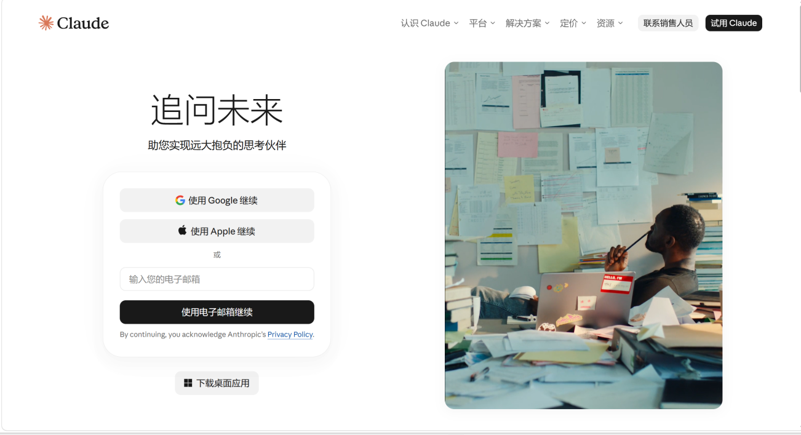
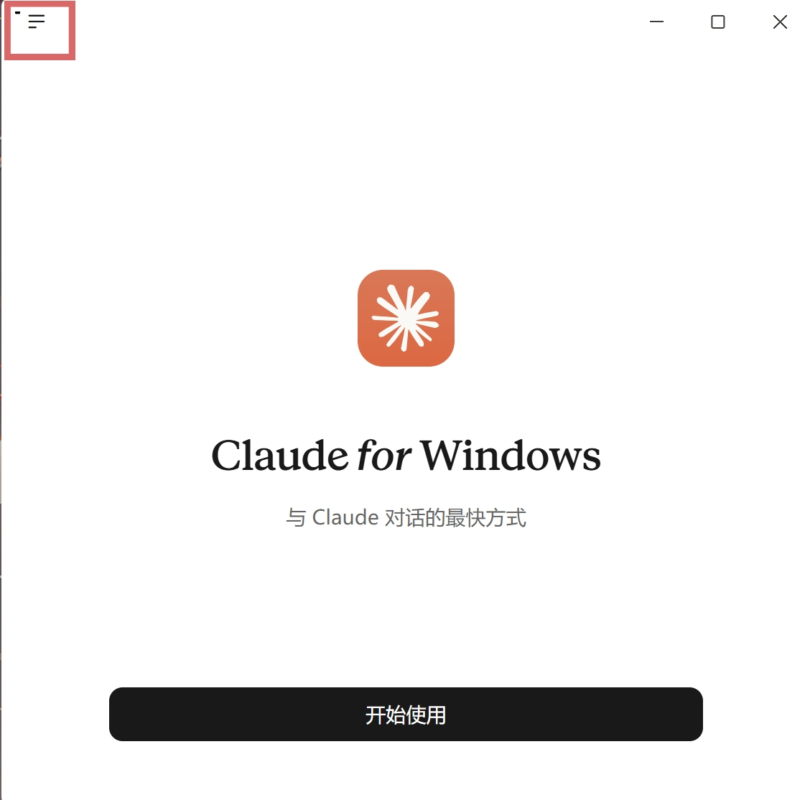
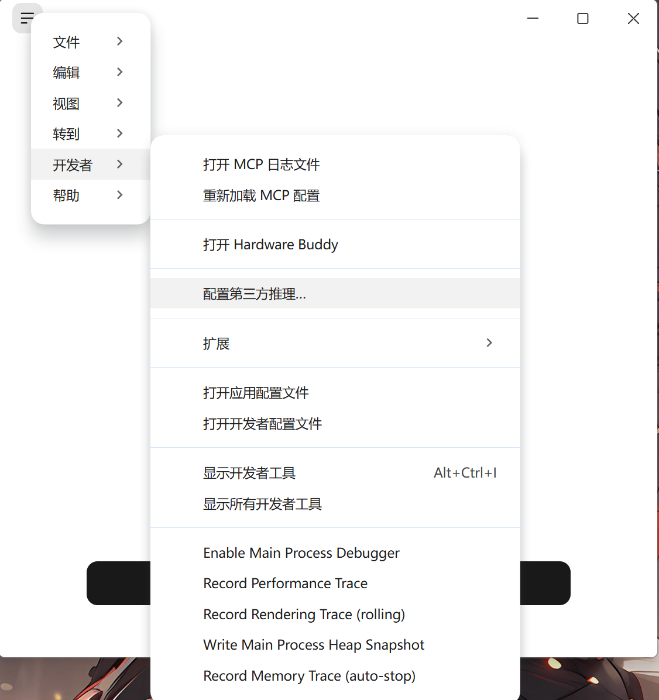
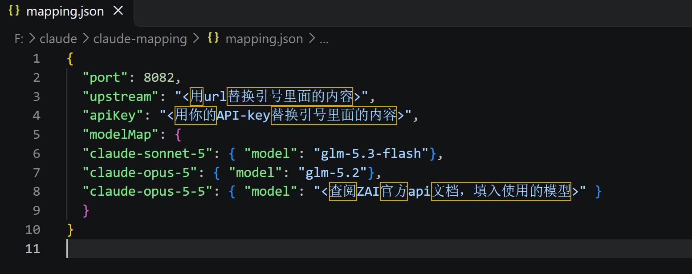
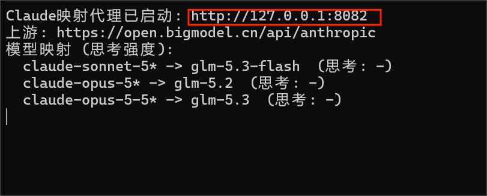
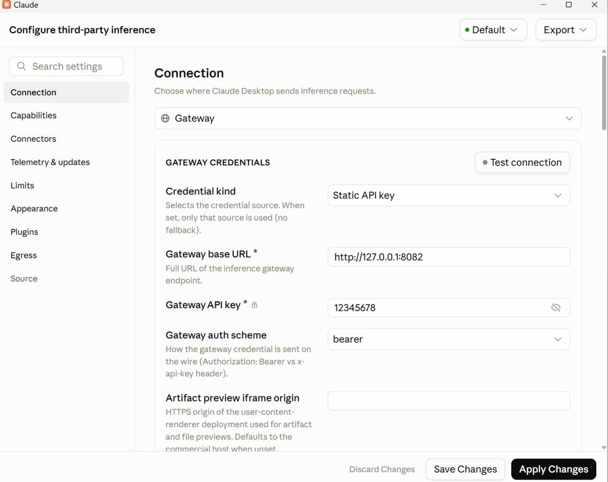
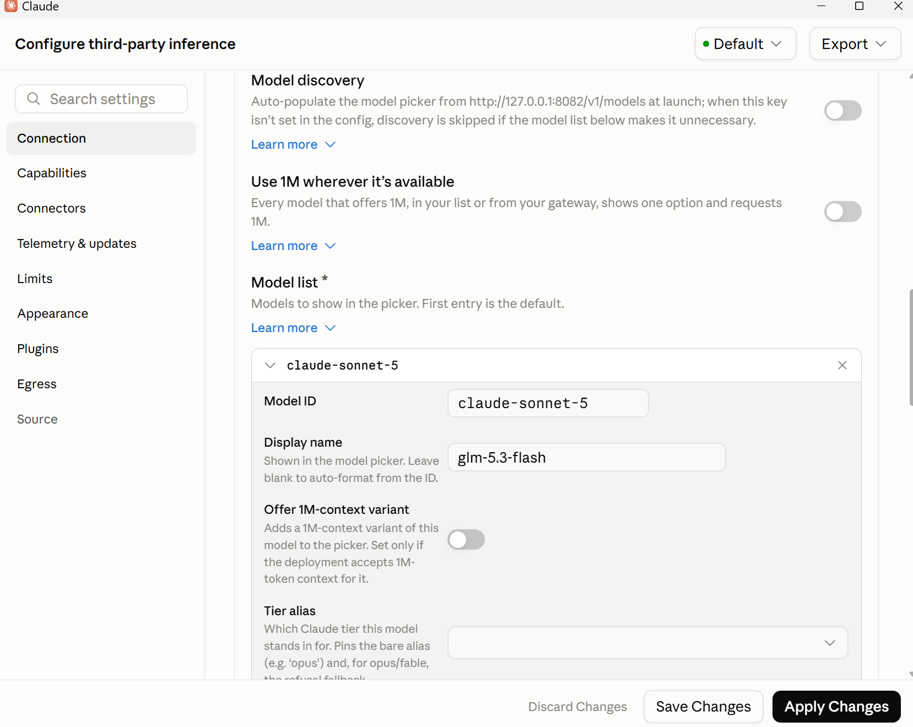
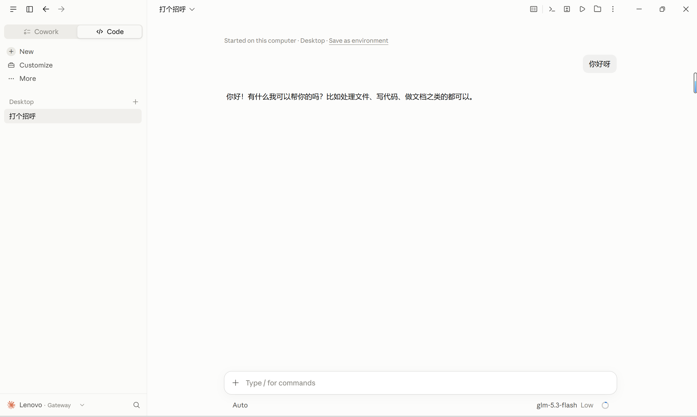

# Claude本地代理接入国产大模型（Windows版）

> ⚠️ **仅限本机 `127.0.0.1` 本地学习测试，禁止公网部署、禁止对外提供中转服务。**

写在前面：近期Koala发现Claude Desktop的最新版本比任意一款Agent（包括Codex）都强大，在项目工程和代码方面尤为出色，但是Anthropic全面禁止大陆使用Claude，而且最新版的Claude Desktop更是加入了官方模型识别，需要模型的映射。Koala搜寻全网，发现使用最多的是第三方软件CCswitch代理，Koala尝试了一下，但是CCswitch偷走了Koala的Token。一怒之下，Koala卸载了CCswitch，在大量的尝试与总结之后，Koala通过写脚本，终于在本地实现了模型的映射和代理。

详细教程：

1. 前置：下载claude-mapping.zip并且解压（暂时不用打开，没有保存路径要求）

2. 使用VPN，在Claude官网下载并安装Claude Desktop，此过程需要VPN网络代理节点稳定，尽量不要更换节点。

   

3. 完成安装后，打开Claude Desktop（此过程不要断开VPN）进入使用页面（不要点击“开始使用”）。点击左上角的三条杠

   

4. 依次点击：Developer（开发者）-Configure third-party inference（配置第三方推理），打开之后不要关闭。（若没有开发者选项，可以在help里面打开，重启应用就出现了）

   

5. 打开claude-mapping，打开mapping，在里面填入url和API-key，填完之后，进行保存，并且退出。（获取url和API-key比较简单，不过多赘述了）

   

6. 打开claude-mapping，打开start-proxy，此时终端会弹出运行框，复制最上面的一行本地代理url地址

   

7. 将刚刚获取的地址填入（步骤4）打开的Configure third-party inference页面，其他按照图片里面的选择。（这里的API-Key可以随便填）

   

8. 在Model list里面点击Add model，在上面一栏填入Claude官方模型，在下面一栏填你需要映射的模型，需要与（步骤5图片）里面modelMap左右两列的模型相同。填完点击Apply Changes，并且完全退出Claude Desktop。然后关闭终端（步骤6打开的）

   

9. 此时，你跟随Koala已经完成了配置，以后每次使用前，先打开claude-mapping里面的start-proxy，然后打开Claude Desktop，就可以使用了。（注意：第一次使用可能需要打开VPN，因为Claude的Harness环境需要连接VPN下载）

   

写在最后：

如果你需要使用其他的模型，只需要在Configure third-party inference和mapping更改url、API-key还有模型配置就行。

（此文档仅供个人学习和参考使用，禁止修改监听地址为公网、禁止搭建公共中转服务）
